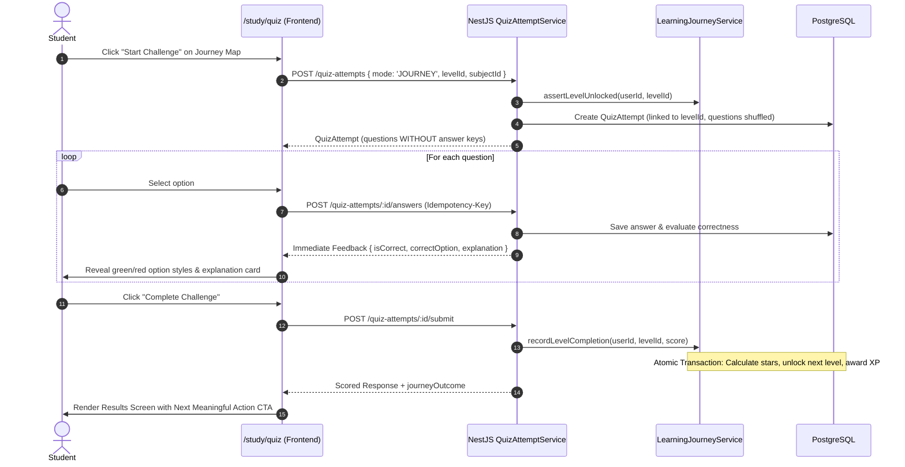

# Panda Learning Platform — Full-Stack & Frontend Architecture Documentation

**Version:** 2.0  
**Last Updated:** September 2026  
**Status:** Active Production Architecture  

---

## Table of Contents

1. [Executive Overview & System Goals](#1-executive-overview--system-goals)
2. [High-Level Architecture & Topology](#2-high-level-architecture--topology)
3. [Frontend Architecture (`WFRONT/mnext`)](#3-frontend-architecture-wfrontmnext)
   - [Directory Structure & Modular Boundaries](#directory-structure--modular-boundaries)
   - [App Router Architecture & Navigation Flow](#app-router-architecture--navigation-flow)
   - [State Management & Data Fetching](#state-management--data-fetching)
   - [UI / UX Design System & Panda Aesthetics](#ui--ux-design-system--panda-aesthetics)
4. [Structured Learning Journey Domain](#4-structured-learning-journey-domain)
   - [Curriculum Hierarchy](#curriculum-hierarchy)
   - [Progression Node Lifecycle & States](#progression-node-lifecycle--states)
   - [Study Center Information Architecture](#study-center-information-architecture)
5. [Unified Question Practice & Challenge Execution Engine](#5-unified-question-practice--challenge-execution-engine)
   - [Single-Engine Design Philosophy](#single-engine-design-philosophy)
   - [Session Lifecycle & Data Flow](#session-lifecycle--data-flow)
   - [Immediate Pedagogical Feedback Pipeline](#immediate-pedagogical-feedback-pipeline)
   - [Resilience, Idempotency & Edge Case Handling](#resilience-idempotency--edge-case-handling)
   - [Results Screen & Next Meaningful Action](#results-screen--next-meaningful-action)
6. [Core Progression & Reward System](#6-core-progression--reward-system)
   - [The Five Progression Dimensions](#the-five-progression-dimensions)
   - [Centralized Reward Policy Architecture](#centralized-reward-policy-architecture)
   - [Anti-Abuse & Anti-Replay Safeguards](#anti-abuse--anti-replay-safeguards)
7. [Database Schema & Entity Models](#7-database-schema--entity-models)
8. [API Contracts & Full-Stack Interfaces](#8-api-contracts--full-stack-interfaces)
9. [Testing, Verification & Operational Runbook](#9-testing-verification--operational-runbook)

---

## 1. Executive Overview & System Goals

Panda is an authoritative, gamified educational platform built for students preparing for the West African Senior School Certificate Examination (WASSCE).

### Core Architectural Principles
1. **Server Authoritative**: All question selection, answer evaluation, scoring, XP grants, level unlocks, and streak calculations are determined exclusively by the server. The client cannot forge scores or rewards.
2. **Unified Execution Engine**: A single, robust quiz and challenge execution engine powers **Journey Challenges**, **Quick Practice**, and **Multiplayer Mode** without duplicating business logic.
3. **Multi-Dimensional Progression**: The system distinguishes between **XP** (effort), **Mastery** (understanding), **Completion** (finishing), **Streak** (consistency), and **Achievements** (milestones).
4. **Resilience & Fault Tolerance**: Sessions withstand browser refreshes, intermittent network disconnects, double clicks, and duplicate payload retries using cryptographic idempotency keys and database constraints.
5. **Cognitive Load Reduction**: The UI prioritizes the student's *next meaningful learning action* rather than forcing complex choices.

---

## 2. High-Level Architecture & Topology

```
 ┌──────────────────────────────────────────────────────────┐
 │                     CLIENT BROWSER                       │
 │  Next.js 16 App Router (React 19, TypeScript, Tailwind)  │
 └────────────────────────────┬─────────────────────────────┘
                              │
                    HTTPS / JSON REST APIs
                    Bearer Token / Idempotency-Key
                              │
 ┌────────────────────────────▼─────────────────────────────┐
 │                  BACKEND APPLICATION                     │
 │          NestJS 11 Modular Monolith (Node.js)            │
 │                                                          │
 │  ┌────────────────────────────────────────────────────┐  │
 │  │ Domain Modules:                                    │  │
 │  │  - ContentModule (Quiz attempts, questions, study) │  │
 │  │  - JourneyModule (Progression map, level states)   │  │
 │  │  - ProgressionModule (Reward policy, XP, badges)   │  │
 │  │  - QuestModule (Daily & weekly quests)             │  │
 │  │  - IdentityModule (Auth, users, guest sessions)    │  │
 │  └────────────────────────────────────────────────────┘  │
 └────────────────────────────┬─────────────────────────────┘
                              │
                Prisma ORM (Connection Pool)
                              │
 ┌────────────────────────────▼─────────────────────────────┐
 │                    DATABASE LAYER                        │
 │         PostgreSQL (Hosted on Neon DB Serverless)        │
 │                                                          │
 │  Tables:                                                 │
 │  - QuizAttempt, QuizAttemptAnswer                        │
 │  - Journey, JourneyStage, JourneyLevel, JourneyChallenge │
 │  - UserLevelProgress, LevelCompletionLog                 │
 │  - XpLedger (@unique idempotencyKey)                     │
 │  - UserStreak, TopicMastery, Achievement, UserAchievement│
 └──────────────────────────────────────────────────────────┘
```

---

## 3. Frontend Architecture (`WFRONT/mnext`)

### Directory Structure & Modular Boundaries

The frontend follows a domain-driven, feature-sliced module structure:

```
WFRONT/mnext/
├── app/                          # Next.js App Router (pages & layouts)
│   ├── (app)/                    # Authenticated student application shell
│   │   ├── dashboard/            # Overview, stats, daily quests
│   │   ├── study/                # Study Center Hub
│   │   │   ├── [subjectSlug]/    # Subject Journey progression map
│   │   │   └── quiz/             # Unified Quiz & Challenge execution engine
│   │   ├── leaderboards/         # Weekly competitive rankings
│   │   ├── profile/              # Student settings & streak history
│   │   └── achievements/         # Permanent milestone badges
│   ├── (auth)/                   # Authentication flows (login, register)
│   └── api/auth/[...proxy]/      # Internal auth reverse proxy
├── features/                     # Feature domain modules
│   ├── curriculum/               # Subjects, stages, levels, journey map
│   │   ├── components/           # JourneyMap, JourneyNode, ContinueJourneyCard
│   │   ├── api.ts                # getSubjectJourney, getCurrentProgress
│   │   └── types.ts              # JourneyLevelItem, LevelProgressState
│   ├── quiz/                     # Quiz engine & question components
│   │   ├── components/           # QuestionCard, OptionSelector, QuizResultsScreen
│   │   ├── api.ts                # createQuizAttempt, submitAnswer, submitQuiz
│   │   ├── hooks.ts              # useQuizAttempt, useSubmitQuizAnswer
│   │   └── types.ts              # AttemptMode, QuizAttempt, ScoredAnswerDto
│   ├── gamification/             # XP, streaks, energy, diamonds
│   └── analytics/                # Study summary & performance tracking
├── lib/                          # Shared cross-cutting utilities
│   ├── api-client.ts             # Typed fetch client with auth injection
│   └── idempotency.ts            # Crypto UUID idempotency key generator
└── styles/                       # Global Tailwind and font declarations
```

### App Router Architecture & Navigation Flow

1. **Study Center (`/study`)**:
   - The central entry point.
   - Top section displays the **Continue Journey Card** with current level, completion percentage, and primary CTA.
   - Second section displays **Play Modes** (Multiplayer challenge & Quick Practice).
   - Bottom section displays **Your Subject Journeys**.

2. **Journey Progression Map (`/study/[subjectSlug]`)**:
   - Visual path representing the curriculum ordered by stages and levels.
   - Clicking an available or current node routes directly into the challenge:
     `/study/quiz?levelId=${level.id}&subjectId=${journey.subjectId}&mode=quiz`

3. **Unified Challenge Execution Engine (`/study/quiz`)**:
   - Renders the interactive quiz interface.
   - Reads URL parameters (`levelId`, `journeyId`, `challengeId`, `attemptId`, `subjectId`, `mode`).
   - Handles the entire active learning loop: answering, instant pedagogical feedback, final scoring, and results.

### State Management & Data Fetching

- **Server State**: Managed via `@tanstack/react-query` (`QueryClient`):
  - Queries: `useQuizAttempt`, `useSubjectJourney`, `useCurrentProgress`, `useEnergy`, `useQuests`.
  - Mutations: `useSubmitQuizAnswer`, `useSubmitQuizAttempt`, `useClaimQuestReward`.
  - Automatic cache invalidation ensures level progress, mastery stars, and XP update immediately when an attempt completes.
- **Client Session State**:
  - `activeAttemptId` is stored in component state and mirrored in the URL query string (`?attemptId=...`) using `window.history.replaceState`.
  - Browser refresh automatically rehydrates the session from the server.
  - `answersMap` tracks option choices locally; `feedbackMap` preserves server-evaluated correctness and explanations.

### UI / UX Design System & Panda Aesthetics

- **Typography**: Inter / Outfit fonts with bold weight hierarchy (`font-black`, `tracking-tight`).
- **Tactile Depth**: Neumorphic-inspired 2D borders:
  `border-[3px] border-border shadow-[0_6px_0_rgba(20,24,39,0.9)]`
- **Dynamic Interaction**:
  - Buttons depress on click: `active:translate-y-0.5 active:shadow-[0_1px_0_#141827]`.
  - Smooth transitions for progress bars and star unlocks.
- **Palette**:
  - Primary: Warm amber / gold `#FCD34D` for progress, rewards, and primary CTAs.
  - Success / Correct: Emerald `#10B981` with checkmark badge.
  - Failure / Incorrect: Rose `#F43F5E` with line-through and cross badge.
  - Surface: Dark clean slate with high contrast borders `#141827`.

---

## 4. Structured Learning Journey Domain

### Curriculum Hierarchy

```
Subject (e.g., Core Mathematics)
  └── Journey (Structured academic path)
        └── Stage (e.g., Stage 1: Foundations of Algebra)
              └── Level (e.g., Level 1: Linear Equations)
                    ├── Challenge (Question set, pass threshold 60%, limit 5)
                    ├── Progress (UserLevelProgress: stars, score, status)
                    └── Completion Log (LevelCompletionLog: immutable audit)
```

### Progression Node Lifecycle & States

Every journey level exists in one of five authoritative server states:

```
┌──────────┐      Prerequisites Met      ┌───────────┐      Student Clicks      ┌──────────┐
│  LOCKED  │ ───────────────────────────►│ AVAILABLE │ ────────────────────────►│  ACTIVE  │
└──────────┘                             └───────────┘                          └────┬─────┘
                                                                                     │
                                                                   Score >= 50%      │
                                         ┌───────────┐            (Passing Threshold)│
                                         │ MASTERED  │◄──────────────────────────────┤
                                         │ (3 Stars) │                               │
                                         └─────▲─────┘                               │
                                               │ Score = 100%                        ▼
                                               │                        ┌────────────────────┐
                                               └────────────────────────┤     COMPLETED      │
                                                                        │ (1 or 2 Stars)     │
                                                                        └────────────────────┘
```

1. **`LOCKED`**: Prerequisites are incomplete. Node is greyed out with a lock icon.
2. **`AVAILABLE`**: Prerequisites satisfied. Ready to start.
3. **`ACTIVE`**: Student is actively attempting or currently studying this level.
4. **`COMPLETED`**: Level completed with a passing score ($\ge 50\%$). Awards base completion XP. Unlocks the next level.
5. **`MASTERED`**: Student achieved highest competence (3 stars, 100% score). Awards mastery bonus XP.

---

## 5. Unified Question Practice & Challenge Execution Engine

### Single-Engine Design Philosophy

Instead of maintaining separate quiz controllers and components for practice and journey challenges, the single quiz engine (`QuizAttemptServiceImpl` on backend, `/study/quiz` on frontend) serves all learning modes:

| Mode | Context Passed | Question Count | Scored Progression? | Level Unlock? |
| :--- | :--- | :--- | :--- | :--- |
| **`JOURNEY`** | `journeyId`, `levelId`, `challengeId` | Level challenge limit (e.g. 5–10) | Yes (Mastery stars + XP) | Yes |
| **`PRACTICE`**| `subjectId`, `topicId` | Default limit (20–40) | Yes (Practice XP) | No |
| **`EXAM`**    | `subjectId`, `mockExamConfigId` | Timed exam (50 questions) | Yes (Exam grade) | No |

### Session Lifecycle & Data Flow



### Immediate Pedagogical Feedback Pipeline

When an option is chosen, feedback is returned synchronously to facilitate immediate learning:
1. `POST /quiz-attempts/:id/answers` returns:
   ```json
   {
     "id": "ans-uuid",
     "questionId": "q-1",
     "selectedOptionId": "B",
     "isCorrect": true,
     "correctOption": "B",
     "explanation": "Dividing both sides by 2 yields x = 2."
   }
   ```
2. The UI immediately:
   - Locks options for that question.
   - Styles the correct option in vivid emerald with a checkmark badge.
   - If incorrect, styles the chosen option in rose red with a strike-through.
   - Expands an explanation card underneath the options explaining *why* the answer is correct.

### Resilience, Idempotency & Edge Case Handling

- **Browser Refresh**: The attempt ID is kept in the URL query string (`?attemptId=...`). On page load, `useQuizAttempt` fetches the attempt from `/quiz-attempts/:id`. Any previously answered questions and feedback are reconstructed. If already submitted, the idempotent submission endpoint restores the results screen.
- **Duplicate Submissions**: All answer submissions include an `Idempotency-Key: <uuid>`. Repeated clicks cannot double-insert answers. `submitQuizAttempt` caches and returns the already-calculated score without re-running XP grants.
- **Session Abandonment**: Students clicking `X` in the header are prompted with a confirmation dialog. Confirming triggers `POST /quiz-attempts/:id/abandon`, which updates the attempt status to `ABANDONED` and cleans up active progress.
- **Network Failures**: React Query mutations display non-intrusive Sonner toast notifications on failure, allowing instant retry without losing selection state.

### Results Screen & Next Meaningful Action

The results screen avoids visual clutter and prioritizes the student's next step:

```
               ┌──────────────────────────────┐
               │         Score Badge          │
               │         80% (4/5)            │
               │       ⭐⭐⭐ 2 Stars          │
               └──────────────┬───────────────┘
                              │
               ┌──────────────▼───────────────┐
               │    ✨ Next Level Unlocked:    │
               │   Simultaneous Equations     │
               └──────────────┬───────────────┘
                              │
               ┌──────────────▼───────────────┐
               │     Primary Meaningful CTA:  │
               │   [CONTINUE TO NEXT LEVEL]   │
               └──────────────┬───────────────┘
                              │
         ┌────────────────────┴────────────────────┐
         ▼                                         ▼
[RETRY FOR 3 STARS]                       [RETURN TO MAP]
```

- **If passed & unlocked next level**: Primary button is `"CONTINUE TO NEXT LEVEL"`, which immediately launches the next level challenge.
- **If passed with 1 or 2 stars**: Secondary action offers `"RETRY FOR 3 STARS"`.
- **If failed**: Primary button is `"RETRY CHALLENGE"`.
- **Detailed Question Review**: Collapsed into an accordion by default, allowing students to inspect question-by-question explanations without overwhelming the primary result.

---

## 6. Core Progression & Reward System

### The Five Progression Dimensions

| Dimension | Meaning | Stored In | Grant Trigger | Anti-Abuse Rule |
| :--- | :--- | :--- | :--- | :--- |
| **XP** | Effort & Activity | `XpLedger` | Correct answers, completion, streak, quests | Unique `idempotencyKey`; 2,500 daily cap |
| **Mastery** | Conceptual Understanding | `TopicMastery`, `UserLevelProgress.masteryStars` | Challenge score tiers (50%, 80%, 100%) | Replays only award delta bonus for *new* stars |
| **Completion** | Finishing Content | `UserLevelProgress.isCompleted` | Passing score ($\ge 50\%$) | Base completion XP awarded strictly once |
| **Streak** | Habit Consistency | `UserStreak` | Daily learning activity | Max 1 increment and 1 reward per UTC day |
| **Achievements**| Academic Milestones | `Achievement`, `UserAchievement` | Met criteria (e.g. 7-day streak) | Permanently unlocked; cannot be duplicated |

### Centralized Reward Policy Architecture

Scattered XP grants were refactored into a centralized service layer:

1. **[`RewardPolicyService`](file:///home/benedict/Repos/WASSCE/WBACK/mnest/src/modules/progression/services/reward-policy.service.ts)**:
   - Question XP: `EASY` = 5 XP, `MEDIUM` = 10 XP, `HARD` = 15 XP.
   - Challenge Completion: 50 XP (awarded once on first completion).
   - Mastery Bonus: 1 Star = 20% bonus, 2 Stars = 60% bonus, 3 Stars = 100% bonus.
   - Streak Milestones: 3-day (+30 XP), 7-day (+70 XP), 14-day (+140 XP), 30-day (+300 XP), 100-day (+1,000 XP).
   - Daily Hard Cap: 2,500 XP maximum per user per calendar day.

2. **[`RewardService`](file:///home/benedict/Repos/WASSCE/WBACK/mnest/src/modules/progression/services/reward.service.ts)**:
   - `awardXp(userId, payload, tx?)`: Atomic ledger entry creation with `idempotencyKey`. Emits `xp.awarded` event.
   - `recordChallengeReward(userId, input, tx?)`: Evaluates completion vs. delta mastery bonus.
   - `recordDailyStreakReward(userId, streakDays, tx?)`: Guarantees one streak award per day using key `streak-${userId}-${utcDate}`.
   - `evaluateAchievements(userId, context, tx?)`: Unlocks badges permanently.

3. **[`AchievementService`](file:///home/benedict/Repos/WASSCE/WBACK/mnest/src/modules/progression/services/achievement.service.ts)**:
   - Evaluates permanent student accomplishments:
     - *First Steps* (first attempt completed)
     - *Perfectionist* (100% score)
     - *Three Star Scholar* (3-star mastery)
     - *Streak Master* (7-day study streak)
     - *Century Scholar* (10 completed challenges)

### Anti-Abuse & Anti-Replay Safeguards

- **No Replay Grinding**: Completing an already-completed level awards 0 base completion XP.
- **Delta-Only Mastery**: If a student scored 1 star previously and achieves 3 stars on retry, they receive only the remaining $80\%$ difference of the mastery bonus.
- **Database Unique Constraints**: `XpLedger.idempotencyKey` prevents race conditions or duplicate awards even under concurrent requests.
- **Daily Cap Enforcement**: Any attempt to script or scrape XP beyond 2,500 XP/day is automatically clamped to 0.

---

## 7. Database Schema & Entity Models

```prisma
// Core Quiz Attempt
model QuizAttempt {
  id                 String             @id @default(uuid())
  userId             String
  mode               AttemptMode        @default(PRACTICE)
  status             AttemptStatus      @default(IN_PROGRESS)
  subjectId          String
  topicId            String?
  subtopicId         String?
  journeyId          String?
  levelId            String?
  challengeId        String?
  score              Float              @default(0.0)
  completed          Boolean            @default(false)
  startedAt          DateTime           @default(now())
  completedAt        DateTime?
  answers            QuizAttemptAnswer[]
  
  @@index([userId])
  @@index([levelId])
}

// Immutable XP Ledger
model XpLedger {
  id             String        @id @default(uuid())
  idempotencyKey String?       @unique
  userId         String
  amount         Int
  source         XpSource
  description    String
  createdAt      DateTime      @default(now())
  user           User          @relation(fields: [userId], references: [id], onDelete: Cascade)

  @@index([userId])
  @@index([createdAt])
  @@index([source])
}

// User Level Progression
model UserLevelProgress {
  id            String             @id @default(uuid())
  userId        String
  levelId       String
  state         LevelProgressState @default(LOCKED)
  bestScore     Float              @default(0.0)
  attemptsCount Int                @default(0)
  masteryStars  Int                @default(0)
  isCompleted   Boolean            @default(false)
  isMastered    Boolean            @default(false)
  completedAt   DateTime?
  masteredAt    DateTime?

  @@unique([userId, levelId])
  @@index([userId, state])
}

// User Streak Tracking
model UserStreak {
  id               String   @id @default(uuid())
  userId           String   @unique
  currentStreak    Int      @default(0)
  longestStreak    Int      @default(0)
  lastActiveDate   String?  // UTC Date: YYYY-MM-DD
  freezesRemaining Int      @default(0)
  updatedAt        DateTime @updatedAt
}

// Enums
enum AttemptMode {
  JOURNEY
  PRACTICE
  EXAM
}

enum XpSource {
  QUIZ_COMPLETE
  DAILY_STREAK
  ACHIEVEMENT
  QUEST_REWARD
  CHALLENGE_COMPLETION
  MASTERY_BONUS
  QUESTION_CORRECT
}

enum LevelProgressState {
  LOCKED
  AVAILABLE
  ACTIVE
  COMPLETED
  MASTERED
}
```

---

## 8. API Contracts & Full-Stack Interfaces

### 1. Create Challenge Attempt
- **Endpoint**: `POST /quiz-attempts`
- **Request**:
  ```json
  {
    "mode": "JOURNEY",
    "subjectId": "subj-math-123",
    "levelId": "lvl-algebra-1",
    "challengeId": "chal-01"
  }
  ```
- **Response (`201 Created`)**:
  ```json
  {
    "id": "att-456",
    "mode": "JOURNEY",
    "status": "IN_PROGRESS",
    "levelId": "lvl-algebra-1",
    "questions": [
      {
        "id": "q-101",
        "text": "Solve for x: 2x + 4 = 10",
        "options": [
          { "key": "A", "text": "x = 2" },
          { "key": "B", "text": "x = 3" }
        ],
        "difficulty": "EASY",
        "type": "MCQ"
      }
    ]
  }
  ```

### 2. Submit Question Answer (Immediate Feedback)
- **Endpoint**: `POST /quiz-attempts/:id/answers`
- **Header**: `Idempotency-Key: 550e8400-e29b-41d4-a716-446655440000`
- **Request**:
  ```json
  {
    "questionId": "q-101",
    "selectedOptionId": "B"
  }
  ```
- **Response (`200 OK`)**:
  ```json
  {
    "id": "ans-999",
    "questionId": "q-101",
    "selectedOptionId": "B",
    "isCorrect": true,
    "correctOption": "B",
    "explanation": "Subtracting 4 yields 2x = 6; dividing by 2 gives x = 3."
  }
  ```

### 3. Complete Challenge Attempt
- **Endpoint**: `POST /quiz-attempts/:id/submit`
- **Response (`200 OK`)**:
  ```json
  {
    "id": "att-456",
    "score": 100,
    "xpAwarded": 75,
    "journeyOutcome": {
      "levelId": "lvl-algebra-1",
      "isPassed": true,
      "masteryStarsEarned": 3,
      "xpEarned": 75,
      "unlockedNextLevel": true,
      "nextLevelId": "lvl-algebra-2",
      "nextLevelTitle": "Simultaneous Equations",
      "summaryMessage": "Challenge Completed! All 3 Stars Mastered."
    }
  }
  ```

### 4. Abandon Attempt
- **Endpoint**: `POST /quiz-attempts/:id/abandon`
- **Response (`200 OK`)**:
  ```json
  {
    "id": "att-456",
    "status": "ABANDONED"
  }
  ```

---

## 9. Testing, Verification & Operational Runbook

### Running Automated Test Suites

From `WBACK/mnest`:

```bash
# Run Progression & Centralized Reward Policy tests
pnpm test src/modules/progression/reward.spec.ts

# Run Quiz Attempt Journey Execution Engine tests
pnpm test src/modules/content/quiz-attempt-journey.spec.ts

# Run Journey Domain & Level Progression tests
pnpm test src/modules/journey/journey-progression.spec.ts

# Run Streak Domain tests
pnpm test src/modules/content/streak.spec.ts

# Run all 4 suites together
pnpm test src/modules/progression/reward.spec.ts \
          src/modules/content/quiz-attempt-journey.spec.ts \
          src/modules/journey/journey-progression.spec.ts \
          src/modules/content/streak.spec.ts
```

### Production Build Verification

```bash
# 1. Compile Backend NestJS
cd /home/benedict/Repos/WASSCE/WBACK/mnest
pnpm build

# 2. Compile Frontend Next.js (TypeScript + Turbopack)
cd /home/benedict/Repos/WASSCE/WFRONT/mnext
pnpm build
```

### Database Synchronization

```bash
cd /home/benedict/Repos/WASSCE/WBACK/mnest
npx prisma db push --accept-data-loss
npx prisma generate
```

---

*Document compiled and maintained for Panda Engineering & Academic Product Teams.*
